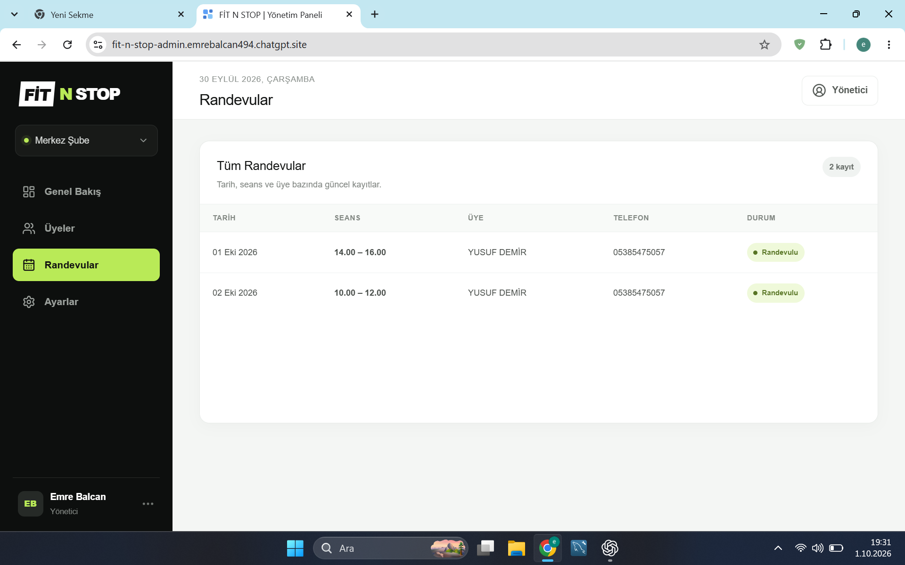
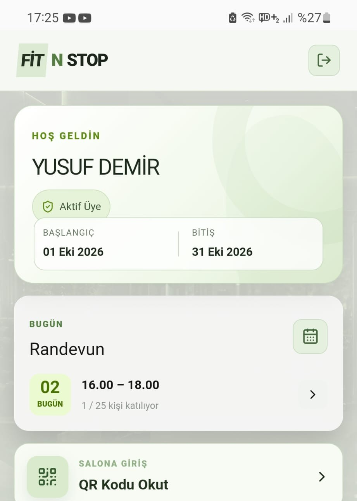

# FİT N STOP

FİT N STOP; spor salonu yöneticileri ve üyeleri için geliştirilmiş, web tabanlı yönetim paneli ile Android mobil uygulamayı aynı sistemde buluşturan tam kapsamlı bir spor salonu yönetim projesidir.

## Canlı bağlantılar

- **Tanıtım ve uygulama indirme:** https://fit-n-stop-admin.emrebalcan494.chatgpt.site
- **Salt okunur yönetici demosu:** https://fit-n-stop-admin.emrebalcan494.chatgpt.site/demo
- **Mobil uygulama:** https://fit-n-stop-admin.emrebalcan494.chatgpt.site/mobil
- **Android APK:** https://fit-n-stop-admin.emrebalcan494.chatgpt.site/fit-n-stop-v1.7.apk

## Ekran görüntüleri

### Yönetici paneli



### Mobil uygulama



## Yönetici paneli

Yönetici paneli salonun günlük operasyonlarını tek ekrandan yönetir.

- Üye ekleme, güncelleme ve silme
- Supabase Auth üzerinden TC kimlik numarası ve şifreyle üye hesabı oluşturma
- Aynı TC kimlik numarasıyla birden fazla kayıt açılmasını engelleme
- Üyelik başlangıç, bitiş, dondurma ve iptal işlemleri
- Üye şifresi sıfırlama
- Randevu ve seans doluluklarını takip etme
- Giriş, çıkış ve hatalı QR hareketlerini canlı görüntüleme
- Giriş, çıkış ve APK indirme QR kodları
- Kapalı gün ve salon bilgileri yönetimi
- Supabase Realtime ile veri değiştiğinde otomatik güncelleme

Herkese açık demo paneli aynı Supabase verisine bağlıdır ve yalnızca örnek hesapların hareketlerini gösterir. Ziyaretçiler ekranları ve pencereleri inceleyebilir; üye ekleme, silme, güncelleme, şifre sıfırlama veya salonu kapatma gibi işlemler yapamaz.

## Mobil uygulama

Mobil arayüz üyelerin salon işlemlerini telefonlarından gerçekleştirmesini sağlar.

- TC kimlik numarası ve şifreyle giriş
- Günlük seanslardan randevu alma ve iptal etme
- Geçmiş seans ve ikinci randevu hakkı kuralları
- QR kodla salona giriş ve çıkış
- Salonda geçirilen süre ve ortalama ziyaret süresi
- Üyelik bilgileri ve bir aylık üyelik dondurma
- Açık ve koyu tema
- Salon iletişim ve konum bilgileri
- Hazır antrenman programları ve hareket anlatımları
- Set, tekrar ve ağırlık takibi
- Antrenman geçmişi ve kişisel kayıtlar

Android uygulaması Capacitor ile paketlenmiştir. Aynı mobil arayüz tarayıcıdan da incelenebilir.

## Örnek kullanıcılar

Tüm örnek hesapların şifresi: **`şifre1234`**

| TC kimlik numarası | Kullanıcı |
|---|---|
| `33333333333` | Zeynep Kaya |
| `44444444444` | Can Arslan |
| `55555555555` | Elif Şahin |
| `66666666666` | Burak Çelik |
| `77777777777` | Derya Aydın |
| `88888888888` | Mert Koç |
| `99999999999` | Selin Aksoy |
| `10101010101` | Deniz Yıldız |
| `12121212121` | Ece Kurt |

Örnek kullanıcıyla mobil uygulamadan alınan randevu, salt okunur demo yönetici panelinde canlı olarak görüntülenebilir.

## Kullanılan teknolojiler

- Next.js, React ve TypeScript
- Supabase Database, Auth ve Realtime
- Capacitor Android
- Cloudflare tabanlı Sites yayını
- QR kod ve kamera entegrasyonu

## Yerel geliştirme

```bash
npm install
npm run dev
```

Gerekli ortam değişkenleri:

```text
NEXT_PUBLIC_SUPABASE_URL
NEXT_PUBLIC_SUPABASE_PUBLISHABLE_KEY
NEXT_PUBLIC_SUPABASE_ANON_KEY
SUPABASE_SERVICE_ROLE_KEY
```

`SUPABASE_SERVICE_ROLE_KEY` yalnızca sunucu ortamında tutulmalıdır ve hiçbir zaman istemci koduna veya GitHub deposuna eklenmemelidir.

## Derleme

```bash
npm run build
```

Android projesi Capacitor ile hazırlanmıştır. Güncel test APK’sı canlı site üzerinden indirilebilir.
